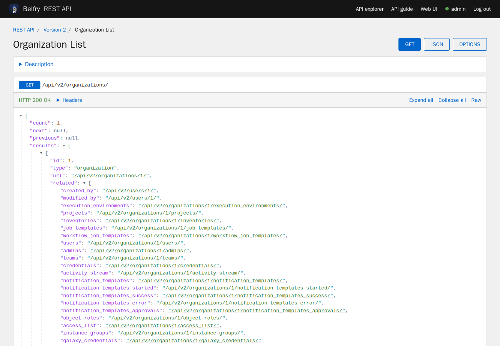
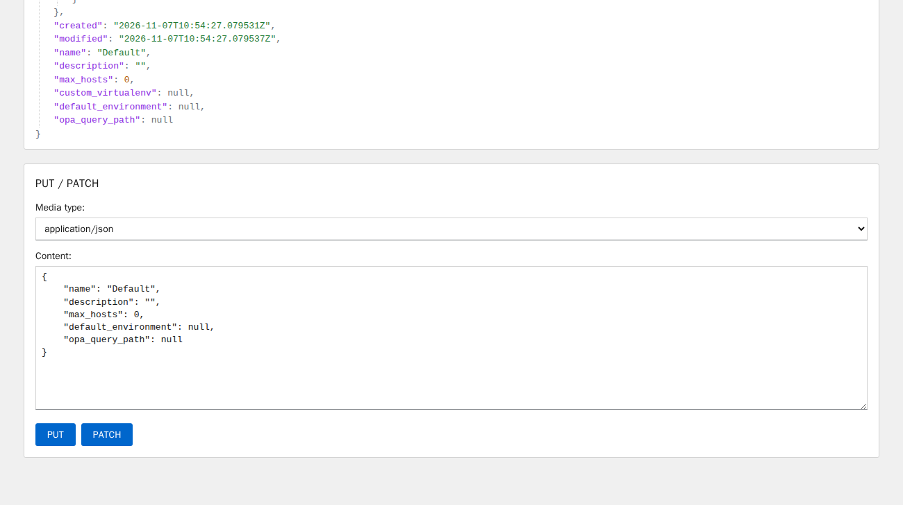

.. _api_browsable_api:

******************
Browsable API
******************

.. index::
   single: browsable API
   single: API; browsable

REST APIs provide access to resources (data entities) via URI paths. You can visit the Belfry REST API in a web browser at ``https://<server name>/api/``. In the browser, every API page shows:

- a top bar with links to the **API explorer** (``/api/v2/docs/``), the API guide and the web UI, and whether you are logged in (with **Log in** or **Log out**);
- breadcrumbs to the parent resources;
- the response as a JSON tree: objects and lists can be collapsed, **Expand all**, **Collapse all** and **Raw** switch the view, and every API path in the response is a link, so you can follow ``related`` resources; **Headers** shows the response headers;
- a **Description** of the endpoint (the access methods and the data it returns);
- forms to send **POST**, **PUT** and **PATCH** requests with a JSON body, and buttons for **OPTIONS** and **DELETE** (after a confirmation).

The pages follow the light or dark appearance of your browser or operating system. **JSON** shows the plain JSON response of a page (``?format=json``).

|REST API|

If you perform a **GET** on the ``/api/`` endpoint, it gives the ``current_version``, which is the recommended version (``/api/v2/``).

The requests run with your user's permissions, using the session of your login. Requests that change something (POST, PUT, PATCH, DELETE) send the CSRF token of the page.

|REST API - POST to API via form|

For an overview of all endpoints with their parameters, and to try requests with a form per operation, use the API explorer at ``/api/v2/docs/``; see :ref:`api_reference`.

You can also view changed settings from factory defaults at ``/api/v2/settings/changed/`` endpoint. It reflects changes you made in the API browser, not changed settings that come from static settings files.
